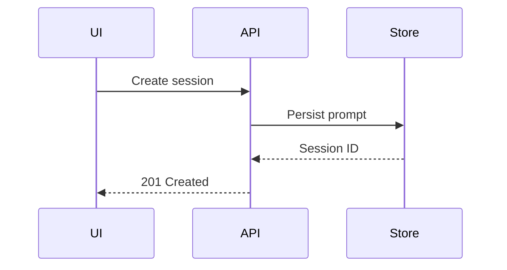

Draft or refine an ExecPlan for the user arguments below, following this document to the letter.
Write the plan to a new Markdown file named `YYYY-MM-DD-<slug>.md` after its creation date.
Check your installed skills first and use any that apply to what you will be building.

# Using PLANS.md for multi-hour problem solving

Modern coding agents can implement complex tasks that take significant time to research, design, and implement. The approach described here is a durable pattern for steering long-running work to successful completion across sessions.

These plans are thorough design documents and "living documents." They give you a chance to verify approach before implementation begins, and they preserve execution context outside the chat transcript so work can be resumed reliably after resets.

You can enable this pattern by adding instructions that define when to use `PLANS.md`, and by checking a `PLANS.md` template into your repository.

## `AGENTS.md`

[`AGENTS.md`](https://github.com/openai/agents.md) is a simple format for guiding coding agents. You can define a shorthand term and a rule for when to use planning documents. Here, we call it an "ExecPlan." (The term is arbitrary; what matters is a clear local definition.)

Here's an `AGENTS.md` section instructing an agent about when to use a plan:

```md
# ExecPlans

When writing complex features or significant refactors, use an ExecPlan (as described in .agent/PLANS.md) from design to implementation.
```

## Operational guardrails

A plan is only effective if it stays current during execution. In practice, the highest-leverage operational rules are:

- Keep `Progress` current at every stopping point, not just at the end of a session.
- Record non-trivial choices in `Decision Log` with rationale.
- Phrase acceptance as observable behavior, not internal code structure.
- Commit plan updates alongside implementation changes at milestone boundaries.
- Before handoff, verify a fresh session could continue from the plan alone.
- At every milestone or stopping point and before handoff, aggressively prune redundant, superseded, or otherwise execution-irrelevant material from the plan. Retain or concisely summarize only the decision rationale, evidence, and recovery context needed to keep the current plan self-contained and safe to execute.

Common failure modes to avoid:

- Referencing context that is not in the plan ("as discussed above", "see architecture doc").
- Reporting acceptance as internals ("added struct X") rather than user-observable outcomes.
- Letting `Progress` drift from actual state.
- Deferring unresolved choices instead of making and logging a decision.

## `PLANS.md`

Below is the entire document. The prompting in this document was carefully chosen to provide significant amounts of feedback to users and to guide the model to implement precisely what a plan specifies. Users may find that they benefit from customizing the file to meet their needs, or adding or removing required sections.

````md
# Execution Plans (ExecPlans)

This document describes the requirements for an execution plan ("ExecPlan"), a design document that a coding agent can follow to deliver a working feature or system change. Treat the reader as a complete beginner to this repository: they have only the current working tree and the single ExecPlan file you provide. There is no memory of prior plans and no external context.

## How to use ExecPlans and PLANS.md

When authoring an executable specification (ExecPlan), follow PLANS.md _to the letter_. If it is not in your context, refresh your memory by reading the entire PLANS.md file. Be thorough in reading (and re-reading) source material to produce an accurate specification. When creating a spec, start from the skeleton and flesh it out as you do your research.

Before finalizing an ExecPlan, align with the user on decisions that materially affect product intent, system architecture, program design, or execution order.
Investigate first: read any existing code or documents, gather context from whatever other related sources are available, report work in flight elsewhere that is likely to conflict with the plan if any, and research current best practice online where you are unsure of the state of the art.
Ask only questions that research cannot answer, in as many rounds as it takes to reach full clarity.
Give each question an index that stays unique across rounds (Q1, Q2, …), context, a recommendation, and tradeoffs.
Keep open questions in the `Open Questions` section; when one is answered, remove it and record the answer in the `Decision Log` in the same edit.
When explaining a consequential design choice, prefer the smallest visual or code-shape sketch that exposes the decision, supported by brief prose, rather than a wall of description. Do not leave consequential decisions unresolved.

When implementing an executable specification (ExecPlan), do not prompt the user for "next steps"; simply proceed to the next milestone until you reach a review point.
A review point is a stop the plan names in advance, in `Progress`, where a human reviews the work before it continues.
Keep all sections up to date, add or split entries in the list at every stopping point to affirmatively state the progress made and next steps. Resolve incidental ambiguities autonomously, and commit frequently.

When discussing an executable specification (ExecPlan), record decisions in a log in the spec for posterity; it should be unambiguously clear why any change to the specification was made. ExecPlans are living documents, and it should always be possible to restart from _only_ the ExecPlan and no other work.

When researching a design with challenging requirements or significant unknowns, use milestones to implement proof of concepts, "toy implementations", etc., that allow validating whether the user's proposal is feasible. Read the source code of libraries by finding or acquiring them, research deeply, and include prototypes to guide a fuller implementation.

## Requirements

NON-NEGOTIABLE REQUIREMENTS:

- Every ExecPlan must be fully self-contained. Self-contained means that in its current form it contains all knowledge and instructions needed for a novice to succeed.
- Every ExecPlan is a living document. Contributors are required to revise it as progress is made, as discoveries occur, and as design decisions are finalized. Each revision must remain fully self-contained. At every milestone, stopping point, and handoff, aggressively remove or condense redundant, superseded, and execution-irrelevant content while preserving the minimum decision rationale, evidence, and recovery context needed to execute the current plan safely.
- Every ExecPlan must enable a complete novice to implement the feature end-to-end without prior knowledge of this repo.
- Every ExecPlan must produce a demonstrably working behavior, not merely code changes to "meet a definition".
- Every ExecPlan must define every term of art in plain language or do not use it.

Purpose and intent come first. Begin by explaining, in a few sentences, why the work matters from a user's perspective: what someone can do after this change that they could not do before, and how to see it working. State the problem in the affected user's terms, not technical ones, and name the signal you will read after shipping to judge the work worthwhile. Sketch any visible surface rather than describing it: use a rough mockup, or the actual command and its output, or, when visual fidelity or interaction is material to a product decision, a focused companion HTML mockup. Then guide the reader through the exact steps to achieve that outcome, including what to edit, what to run, and what they should observe.

The agent executing your plan can list files, read files, search, run the project, and run tests. It does not know any prior context and cannot infer what you meant from earlier milestones. Repeat any assumption you rely on. Do not point to external blogs or docs; if knowledge is required, embed it in the plan itself in your own words. If an ExecPlan builds upon a prior ExecPlan and that file is checked in, incorporate it by reference. If it is not, you must include all relevant context from that plan.

## Formatting

An ExecPlan is a Markdown file, not a fenced block embedded in another response. Use ordinary fenced code blocks with accurate language labels for diagrams, diffs, source code, commands, and transcripts. Use indented text blocks for lightweight component trees, call trees, file trees, and pseudocode when a language label would add no value. Use two newlines after every heading, use # and ## and so on, and use correct Markdown syntax for ordered and unordered lists.

Write reasoning and narrative in plain prose.
Write three or more parallel items (files, terms, rules, test surfaces) as a list, not as a run-on sentence or paragraph.
Avoid tables unless they communicate structure more directly than a list.
Checklists belong in `Progress`, where they are mandatory, so the implementer can tick steps off.
Architecture and program-design artifacts are exempt when their form communicates structure more directly than prose.

## Guidelines

Self-containment and plain language are paramount. If you introduce a phrase that is not ordinary English ("daemon", "middleware", "RPC gateway", "filter graph"), define it immediately and remind the reader how it manifests in this repository (for example, by naming the files or commands where it appears). Do not say "as defined previously" or "according to the architecture doc." Include the needed explanation here, even if you repeat yourself.

Avoid common failure modes. Do not rely on undefined jargon. Do not describe "the letter of a feature" so narrowly that the resulting code compiles but does nothing meaningful. Do not outsource key decisions to the reader. When ambiguity exists, resolve it in the plan itself and explain why you chose that path. Err on the side of over-explaining user-visible effects and under-specifying incidental implementation details.

Anchor the plan with observable outcomes. State what the user can do after implementation, the commands to run, and the outputs they should see. Acceptance should be phrased as behavior a human can verify ("after starting the server, navigating to [http://localhost:8080/health](http://localhost:8080/health) returns HTTP 200 with body OK") rather than internal attributes ("added a HealthCheck struct"). If a change is internal, explain how its impact can still be demonstrated (for example, by running tests that fail before and pass after, and by showing a scenario that uses the new behavior).

Specify repository context explicitly. Name files with full repository-relative paths, name functions and modules precisely, and describe where new files should be created. If touching multiple areas, include a short orientation paragraph that explains how those parts fit together so a novice can navigate confidently. When running commands, show the working directory and exact command line. When outcomes depend on environment, state the assumptions and provide alternatives when reasonable.

Separate system architecture from program design. System architecture explains how affected services, endpoints, schemas, queues, stores, and external actors interact. Program design pins down the shape of the code: ownership, module boundaries, runtime control flow, state, key types, and method signatures. Make consequential decisions reviewable before implementation instead of deferring them to code review.

Check the program design against these principles, and record any deliberate deviation in the `Decision Log`:

- Make invalid states unrepresentable: prefer types to tests, and compile-time boundaries to runtime checks.
- Treat every added line, whether code, prose, or configuration, as a maintenance burden; prefer deletion, reuse, and simplification.
- Organize code by vertical slice, and avoid coupling between distant parts of the system.
- Prefer a functional style to object orientation.
- Favor simplicity over hedging for completeness.
- For each change, first make the change easy (even if this may be hard), then make the easy change.
- Make state machines explicit instead of leaving them implicit.
- Prefer deterministic enforcement over documentation that can be skipped.
- Prefer a stack of small, independently reviewable changes to one large change.

Choose the smallest set of artifacts that makes those decisions obvious. Do not include every available artifact, and do not create a diagram merely to decorate the plan. Each artifact must be warranted by answering a specific design or review question. Use:

- a component tree for frontend ownership, important state, hooks, and module boundaries;
- a shallow file tree for repository location and responsibility, with one short responsibility note per relevant entry;
- a call tree when the change adds an entry point, reorders calls, changes error propagation, or crosses a thread, process, or service boundary;
- pseudocode for algorithms, branching behavior, retries, and failure paths;
- types and function or method signatures for contracts that an implementer could otherwise misinterpret;
- a sequence diagram for interactions whose order across actors or boundaries matters;
- a state diagram for a lifecycle with meaningful transitions, guards, or terminal states; and
- a focused HTML or other visual mockup only when layout, visual fidelity, responsiveness, or interaction is itself under review.

Use diff syntax when most of the surrounding shape already exists and the important point is what changes. Show the complete target shape when most of it is new, when omitted context would hide ownership or order, or when the implementer needs a copyable specification. Keep only the files, calls, props, states, and boundaries needed to understand the decision. If no visual or code-shape artifact would reduce ambiguity, say so briefly rather than inventing one.

A shallow file-tree diff can make a change in ownership obvious:

```diff
 src/
 ├── sessions/
-└── transport.ts
+└── transport/
+    ├── client.ts       # request and response mapping
+    └── stream.ts       # reconnect and backoff policy
```

A call-tree diff can isolate a meaningful control-flow change:

```diff
 submitForm
   createSession
+    enforceQuota
     persistPrompt
     launchAgent
+      fetchPriorTurns
```

A sequence diagram can show ordering across a runtime boundary without narrating every call:



Component trees, state diagrams, pseudocode, and signature blocks should follow the same rule: include the minimum detail that resolves the design question.

A companion HTML mockup is a review aid, never the sole source of required context. Store it at a repository-relative path named in the ExecPlan, summarize the decision it demonstrates in the plan, and ensure the plan remains self-contained and executable if the companion file is unavailable.

Be idempotent and safe. Write the steps so they can be run multiple times without causing damage or drift. If a step can fail halfway, include how to retry or adapt. If a migration or destructive operation is necessary, spell out backups or safe fallbacks. Prefer additive, testable changes that can be validated as you go.

Validation is not optional. Include instructions to run tests, to start the system if applicable, and to observe it doing something useful. Describe comprehensive testing for any new features or capabilities. Include expected outputs and error messages so a novice can tell success from failure. Where possible, show how to prove that the change is effective beyond compilation (for example, through a small end-to-end scenario, a CLI invocation, or an HTTP request/response transcript). State the exact test commands appropriate to the project’s toolchain and how to interpret their results. Plan property-based tests where the behavior has an invariant (a round trip, idempotence, monotonicity, no valid input causing a crash), and mutation testing where you doubt the tests would catch a regression; plan neither by default.

When the change is visible to a person, end the work with a manual verification at a review point before the change is handed over for integration. Run the system and give the reviewer one block per acceptance criterion: the URL or command to use, the expected result, and what you already observed yourself. Name unchanged behavior worth a glance as well. Open each URL for the reviewer where you can, and keep the system running until they confirm. Name the test or sample data that shows each case, and add what is missing. While the system runs, capture evidence for whoever reviews or accepts the change: screenshots for static changes, and a short video for anything that only shows over time, made with a script kept next to the plan so the same captures can be repeated later.

Capture evidence. When your steps produce terminal output, short diffs, or logs, include them as accurately labeled fenced blocks or concise indented examples. Keep them focused on what proves success. If you need to include a patch, prefer file-scoped diffs or small excerpts that a reader can recreate by following your instructions rather than pasting large blobs.

## Milestones

Milestones are narrative, not bureaucracy. If you break the work into milestones, introduce each with a brief paragraph that describes the scope, what will exist at the end of the milestone that did not exist before, the commands to run, and the acceptance you expect to observe. Keep it readable as a story: goal, work, result, proof. Progress and milestones are distinct: milestones tell the story, progress tracks granular work. Both must exist. Never abbreviate a milestone merely for the sake of brevity, do not leave out details that could be crucial to a future implementation.

Each milestone must be independently verifiable and incrementally implement the overall goal of the execution plan.

Organize milestones as vertical slices: thin increments that produce observable behavior through every affected layer needed for that increment. Do not group all database work, service work, API work, and frontend work into separate milestones. Make each slice exercisable through a browser, command, request, integration test, or similarly concrete demonstration. Order slices middle-out: start where behavior first becomes observable, then extend outward in both directions. Order slices to expose uncertain or high-risk decisions early. A slice may use mock data or a temporary adapter when that makes the result exercisable; state how a later slice removes or replaces it. Size each slice to be reviewable in one sitting and end it at a commit that leaves the tree working. Because implementation does not pause for approval, name in each slice the one or two files carrying its substance and the decision most likely to be wrong.

## Living plans and design decisions

- ExecPlans are living documents. As you make key design decisions, update the plan to record both the decision and the thinking behind it. Record all decisions in the `Decision Log` section.
- ExecPlans must contain and maintain a `Progress` section, an `Open Questions` section, a `Surprises & Discoveries` section, a `Decision Log`, and an `Outcomes & Retrospective` section. These are not optional.
- When you discover optimizer behavior, performance tradeoffs, unexpected bugs, or inverse/unapply semantics that shaped your approach, capture those observations in the `Surprises & Discoveries` section with short evidence snippets (test output is ideal).
- If you change course mid-implementation, document why in the `Decision Log` and reflect the implications in `Progress`. Plans are guides for the next contributor as much as checklists for you.
- At completion of a major task or the full plan, write an `Outcomes & Retrospective` entry summarizing what was achieved, what remains, and lessons learned.
- Keep design artifacts synchronized with consequential design changes. Before completion, reconcile proposed visuals and code-shape sketches with the shipped behavior; update or remove stale views rather than preserving a misleading target state. Preserve the reason for a changed design in the `Decision Log`.

## Prototyping milestones and parallel implementations

It is acceptable—and often encouraged—to include explicit prototyping milestones when they de-risk a larger change. Examples: adding a low-level operator to a dependency to validate feasibility, or exploring two composition orders while measuring optimizer effects. Keep prototypes additive and testable. Clearly label the scope as “prototyping”; describe how to run and observe results; and state the criteria for promoting or discarding the prototype.

Prefer additive code changes followed by subtractions that keep tests passing. Parallel implementations (e.g., keeping an adapter alongside an older path during migration) are fine when they reduce risk or enable tests to continue passing during a large migration. Describe how to validate both paths and how to retire one safely with tests. When working with multiple new libraries or feature areas, consider creating spikes that evaluate the feasibility of these features _independently_ of one another, proving that the external library performs as expected and implements the features we need in isolation.

## Skeleton of a Good ExecPlan

    # <Short, action-oriented description>

    This ExecPlan is a living document. The sections `Progress`, `Open Questions`, `Surprises & Discoveries`, `Decision Log`, and `Outcomes & Retrospective` must be kept up to date as work proceeds.

    If PLANS.md file is checked into the repo, reference the path to that file here from the repository root and note that this document must be maintained in accordance with PLANS.md.

    ## Purpose / Big Picture

    Explain in a few sentences what someone gains after this change and how they can see it working. State the user-visible behavior you will enable.

    ## Progress

    Use a list with checkboxes to summarize granular steps. Every stopping point must be documented here, even if it requires splitting a partially completed task into two (“done” vs. “remaining”). This section must always reflect the actual current state of the work.

    - [x] (2025-10-01 13:00Z) Example completed step.
    - [ ] Example incomplete step.
    - [ ] Example partially completed step (completed: X; remaining: Y).
    - [ ] Review point: examples approved.

    Use timestamps to measure rates of progress.

    ## Open Questions

    Only questions still waiting for an answer, each with its index, context, a recommendation, and tradeoffs. When one is answered, remove it in the same edit that records the answer in the `Decision Log`. Leave the section empty rather than deleting it.

    ## Surprises & Discoveries

    Document unexpected behaviors, bugs, optimizations, or insights discovered during implementation. Provide concise evidence.

    - Observation: …
      Evidence: …

    ## Decision Log

    Record every decision made while working on the plan in the format:

    - Decision: …
      Rationale: …
      Date/Author: …

    ## Outcomes & Retrospective

    Summarize outcomes, gaps, and lessons learned at major milestones or at completion. Compare the result against the original purpose.

    ## Context and Orientation

    Describe the current state relevant to this task as if the reader knows nothing. Name the key files and modules by full path. Define any non-obvious term you will use. Do not refer to prior plans.

    ## System Architecture

    Include this section when the change affects interactions across services, processes, storage systems, external actors, or other runtime boundaries. Use the smallest useful contract sketch, data-flow view, or sequence or state diagram. Omit this section when there is no architectural change rather than filling it with boilerplate.

    ## Program Design

    Pin the shape of the code before describing the work. Select only the artifacts that reduce ambiguity: a component tree, shallow file-tree or file-tree diff, call tree or call-tree diff, pseudocode, diagram, or key type and signature block. Use diff form for a mostly existing shape and a complete block for a mostly new shape. Do not require a particular artifact when it would add no useful information.

    ## Plan of Work

    Describe, in prose, the sequence of vertical slices. For each slice, state its observable result, the edits and additions required, and how to exercise it before proceeding. Name each file and location (function, module) and what to insert or change. Keep it concrete and minimal.

    ## Concrete Steps

    List the steps as checkboxes, each with the exact command to run and where to run it (working directory). When a command generates output, show a short expected transcript so the reader can compare. This section must be updated as work proceeds.

    ## Validation and Acceptance

    Describe how to start or exercise the system and what to observe. Phrase acceptance as behavior, with specific inputs and outputs. If tests are involved, say "run <project’s test command> and expect <N> passed; the new test <name> fails before the change and passes after>".

    ## Idempotence and Recovery

    If steps can be repeated safely, say so. If a step is risky, provide a safe retry or rollback path. Keep the environment clean after completion.

    ## Artifacts and Notes

    Include the most important transcripts, diffs, diagrams, mockups, or snippets. Keep them concise and focused on what proves success or clarifies a design decision. Identify likely downstream reuse only where it would help a real audience: for example, a change-oriented call-tree diff in a pull request, a decision-focused sequence diagram in an issue comment, or a current-state architecture view in long-term documentation. Publication is not mandatory.

    Treat these as reusable source material, not text to copy blindly. Before promoting an artifact, reconcile it with the implemented behavior and adapt it to its destination. Pull requests should emphasize what changed and where reviewers should look; issue comments should emphasize the decision, progress, or open question; long-term documentation should describe the current system and remove temporary planning or diff notation. Prefer one version-controlled canonical source with links from other destinations when practical.

    ## Interfaces and Dependencies

    Be prescriptive. Name the libraries, modules, and services to use and why. Specify the types, traits/interfaces, and function signatures that must exist at the end of the milestone, elaborating on `Program Design`. Prefer stable names and paths such as `crate::module::function` or `package.submodule.Interface`. E.g.:

    In crates/foo/planner.rs, define:

        pub trait Planner {
            fn plan(&self, observed: &Observed) -> Vec<Action>;
        }

If you follow the guidance above, a single, stateless agent -- or a human novice -- can read your ExecPlan from top to bottom and produce a working, observable result. That is the bar: SELF-CONTAINED, SELF-SUFFICIENT, NOVICE-GUIDING, OUTCOME-FOCUSED.

When you revise a plan, you must ensure your changes are comprehensively reflected across all sections, including the living document sections, and you must write a note at the bottom of the plan describing the change and the reason why. ExecPlans must describe not just the what but the why for almost everything.
````

(User arguments: $@)
